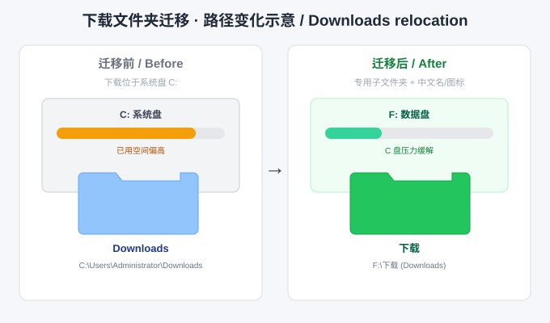

# Windows Downloads Relocator

> 将 Windows「下载」已知文件夹安全地迁移到其他盘的专用子文件夹：迁移前全面检查、逐文件校验迁移、注册表完整备份与明确失败汇总；修复隐藏的 `Local Downloads` 注册表项、规避「整盘 = 下载」陷阱、保持中文名与图标一致，并同步浏览器与网盘 / IM 软件的下载路径。
>
> Safely relocate the Windows **Downloads** known folder to a dedicated sub-folder on another drive. Pre-flight checks, per-file verified migration, full registry backups and honest pass/fail reporting. Fixes the hidden `Local Downloads` GUID, blocks the "whole drive = Downloads" mistake, keeps the localized name (下载) and icon via `desktop.ini`, and syncs common apps' default download directories (Chromium / Edge, Firefox, WeChat, QQ, Baidu / Quark / Ali Netdisk).

[](https://github.com/banshan83/windows-downloads-relocator/blob/main/LICENSE)
[](CHANGELOG.md)
[](https://github.com/banshan83/windows-downloads-relocator)
[](https://github.com/banshan83/windows-downloads-relocator)

---

## 特性 / Features

**核心能力 / Core**

- **防整盘陷阱 / Whole-drive guard** — 目标必须是子文件夹（如 `D:\Downloads`），裸盘符根、UNC、可移动盘/网络盘、受保护目录、嵌套目录一律拒绝（exit 2）。
- **双 GUID 修复 / Both GUIDs** — 侧栏「下载」实际读取 `Local Downloads`（`{7D83EE9B-...}`），本工具同时写三处值并**逐一读回校验**。
- **中文名 + 图标 / Name & icon** — 自动写入 `desktop.ini`（`CLSID2` + `LocalizedResourceName` + `IconResource`），并用 `SHChangeNotify` 刷新 shell。
- **软件路径同步 / App sync** — Chromium/Edge、Firefox、微信、QQ、百度/夸克/阿里云盘（尽力而为，不能自动改的给出手动入口）。

**v1.1.0 可靠性增强 / Reliability**

- **迁移前全面检查 / Pre-flight** — 盘符类型、可用空间、同名冲突、可写性、运行中的应用；有 ERROR 即在任何写入之前中止。
- **逐文件校验 / Verified migration** — `robocopy` 退出码判定 + 快照比对 + 失败项单独重试 + 明确失败清单（exit 4），不再"失败只报成功"。
- **真正只读的预览 / Real dry run** — `-DryRun` / `-WhatIf` 不写 `.reg`、manifest、目录或注册表；由 `selftest.ps1` 断言验证。
- **完整备份 / Faithful backups** — `reg.exe export` 保留 `REG_EXPAND_SZ` 类型，另写 JSON manifest 供回退脚本使用。
- **自动测试 / Automated selftest** — 打包、编码、语法、v1.0.0 回归、版本一致性、文档引用、纯函数单测、迁移闭环、DryRun 零写入。
- **一键回退 / Rollback script** — `restore_downloads.ps1` 按 manifest 恢复注册表指向。

---

## 版本 / Version

当前版本：**v1.1.1**（变更记录见 [`CHANGELOG.md`](CHANGELOG.md)）。

版本号遵循 [语义化版本 2.0.0](https://semver.org/lang/zh-CN/)（`主版本.次版本.修订号`）：

- **主版本**：迁移脚本逻辑 / 注册表键位发生破坏性变更；
- **次版本**：新增支持的软件、新增功能或明显增强（如 v1.1.0 的可靠性重构）；
- **修订号**：文档、文案、向后兼容的 Bug 修复。

发版步骤：跑 `scripts/selftest.ps1` 并确认全部 PASS → 更新 `SKILL.md` frontmatter `version`、本文件 badge 与版本号 → 在 `CHANGELOG.md` 追加条目 → `git tag vX.Y.Z` → GitHub Release（附 `dist/windows-downloads-relocator.zip`）。
*Release checklist: selftest first, then bump all three version locations.*

> **打包约定 / Packaging rule**：每次发版由 `publish_skill.py` 产出并校验**两个包**：
>
> | 包 | 用途 | 内容 |
> |---|---|---|
> | `windows-downloads-relocator.zip` | GitHub Release / 通用完整版 | 排除隐藏文件，保留 `LICENSE` |
> | `windows-downloads-relocator-skillhub.zip` | **SkillHub 专用** | **仅 `.md` / `.ps1` 纯文本**，零二进制、零隐藏文件 |
>
> SkillHub 已确认拒绝四类文件：隐藏文件（`.gitignore`）、无扩展名文件（`LICENSE`）、`.template` 后缀（`desktop.ini.template`）、**以及任何二进制文件（`icon.png`）**。因此 SkillHub 包被收紧为纯文本：`.gitignore` 只留在 GitHub 仓库；`desktop.ini` 由 `scripts/relocate_downloads.ps1` 内嵌生成、内容并入 `references/registry-reference.md`；MIT 许可信息内嵌本页；示意图改为 `references/diagram.md` 里的 SVG 源码；渲染版图片与图标只留在仓库 / 完整包。打包器还会做**二进制内容检测**，不再只靠扩展名判断。从分发包内运行自检请加 `-DistributionMode`。
> *SkillHub rejects dotfiles, extension-less files, .template files and all binary content; a strictly text-only zip is produced for it.*

---

## 目录结构 / Structure

```
windows-downloads-relocator/
├── SKILL.md                          # WorkBuddy skill 定义（触发条件、流程、资源索引）
├── README.md                         # 本文件
├── CHANGELOG.md                      # 版本变更记录
├── LICENSE                           # MIT 许可证（仅源码仓库；SkillHub 包不含）
├── .gitignore                        # 仅 GitHub 仓库；不随分发包提供 (repo-only)
├── scripts/
│   ├── relocate_downloads.ps1        # 核心：预检 + 备份 + 迁移校验 + 双 GUID + 名称/图标 + 校验
│   ├── set_app_downloads.ps1         # 同步浏览器 / 网盘 / IM 的下载路径
│   ├── restore_downloads.ps1         # 按 manifest 回退注册表指向
│   ├── selftest.ps1                  # 自动回归测试（无副作用）
│   └── lib/
│       └── DownloadsCommon.ps1       # 可单测的纯校验 / 快照函数
├── references/
│   ├── registry-reference.md         # 注册表项、两个 GUID、整盘陷阱、备份与回退
│   ├── app-paths.md                  # 各软件下载目录位置、兼容矩阵与手动入口
│   ├── FAQ.md                        # 高频问题集中答复
│   └── diagram.md                    # 示意图说明 + 完整 SVG 源码（纯文本）
└── assets/                           # 仅仓库 / 完整包：渲染示意图与图标，非运行时依赖
    ├── example-before-after.svg
    └── icon.png
```

> SKILL.md 与 README 中指向**包内文件**的相对路径都由 `selftest.ps1` 自动核对；仓库展示资源用绝对 URL 标注，不属于包内承诺。`references/diagram.md` 保证纯文本包里也有完整示意图内容。
> *Selftest verifies every in-package relative path; repo-only images are referenced by absolute URL.*

---

## 安装 / Installation

**方式一：作为 WorkBuddy Skill**
把本仓库克隆 / 复制到 `~/.workbuddy/skills/`（用户级）或 `<项目>/.workbuddy/skills/`（项目级）：

```bash
git clone https://github.com/banshan83/windows-downloads-relocator.git ~/.workbuddy/skills/windows-downloads-relocator
```

**方式二：直接运行脚本**
无需 WorkBuddy，普通 PowerShell 即可。**不需要管理员权限**（只写 HKCU 与用户配置文件）。
*No administrator rights required - HKCU and per-user configs only.*

---

## 使用方法 / Usage

```powershell
# 0) 首次使用 / 发版前：自动自检（无副作用）
powershell -ExecutionPolicy Bypass -File scripts/selftest.ps1
#    若从 SkillHub 下载的分发包内运行（无 .gitignore），加 -DistributionMode
powershell -ExecutionPolicy Bypass -File scripts/selftest.ps1 -DistributionMode

# 1) 只读预览：看预检报告与执行计划，不写任何东西
powershell -ExecutionPolicy Bypass -File scripts/relocate_downloads.ps1 -TargetPath "D:\Downloads" -DryRun

# 2) 执行迁移
powershell -ExecutionPolicy Bypass -File scripts/relocate_downloads.ps1 -TargetPath "D:\Downloads"

# 3) 关闭浏览器/微信/QQ/网盘后，同步软件下载路径（同样支持 -DryRun）
powershell -ExecutionPolicy Bypass -File scripts/set_app_downloads.ps1 -TargetPath "D:\Downloads" -DryRun
powershell -ExecutionPolicy Bypass -File scripts/set_app_downloads.ps1 -TargetPath "D:\Downloads"

# 4) 如需回退（只恢复指向，不搬回文件）
powershell -ExecutionPolicy Bypass -File scripts/restore_downloads.ps1 -BackupDir "$env:USERPROFILE" -DryRun
powershell -ExecutionPolicy Bypass -File scripts/restore_downloads.ps1 -BackupDir "$env:USERPROFILE"
```

`relocate_downloads.ps1` 执行时依次：

1. 校验目标（拒绝盘符根 / UNC / 可移动盘 / 网络盘 / 受保护目录 / 嵌套目录）；
2. 预检：源目录清单、可用空间、同名冲突、可写性、运行中的应用；有 ERROR 立即中止；
3. `reg.exe export` 备份两个注册表键（保留 `REG_EXPAND_SZ`）+ 写 JSON manifest；
4. 建目录，用 `robocopy /MOVE` 迁移并**逐文件校验**，失败项单独重试、仍失败则列明并以 exit 4 退出；
5. `SHSetKnownFolderPath` + 三处注册表写入，逐一读回校验；
6. 写 `desktop.ini` 恢复名称与图标，`SHChangeNotify` 通知 shell；
7. 重启并重新拉起 Explorer，做最终校验，输出 SUMMARY。

更多场景（修复整盘事故、只改指向不搬文件、目标已有同名文件、无人值守）见 [`SKILL.md`](SKILL.md) 的「多场景示例」。
*More scenarios are documented in SKILL.md.*

---

## 能力边界 / Scope & limits

| 项 / Item | 支持 / Supported | 不支持 / Not supported |
|---|---|---|
| 系统 | Windows 10 / 11 | Windows 7/8、Server Core |
| Shell | Windows PowerShell 5.1+ | PowerShell 7 未完整验证 |
| 目标卷 | **固定本地磁盘** | 盘符根、U 盘/移动硬盘、网络盘、光驱、UNC |
| 显示名 | 跟随系统 UI 语言（简中「下载」） | 不强制任意自定义中文名 |
| 软件自动同步 | Chromium、Firefox、微信、QQ、百度/夸克/阿里云盘 | 迅雷、Telegram、Steam、游戏启动器、按账号加密存储的客户端 |
| 文件回退 | 恢复注册表指向 | **不会把文件搬回**（物理移动） |

**迁移出错的后果**：备份失败（exit 3）时不会改任何注册表；文件未通过校验会明确列出并 exit 4，原文件尽可能保留；回退只恢复指向；目标在系统盘不会释放空间（WARN）。详见 [`references/FAQ.md`](references/FAQ.md)。
*Consequences of failure are documented explicitly in the FAQ.*

---

## 工作原理 / How it works

Windows 的「下载」是 **Known Folder**，由 `HKCU\Software\Microsoft\Windows\CurrentVersion\Explorer\User Shell Folders` 下多个值定义。常见踩坑：

- **整盘陷阱**：目标写成 `D:\` 而非 `D:\Downloads`，整块盘被登记为下载目录；
- **隐藏的 Local Downloads**：侧栏读 `{7D83EE9B-2244-4E70-B1F5-5393042AF1E4}`，只改 `{374DE290-...}` 无效；
- **中文名丢失**：自建文件夹缺 `desktop.ini`，资源管理器显示英文 `Downloads`。

详见 [`references/registry-reference.md`](references/registry-reference.md) 与 [`references/app-paths.md`](references/app-paths.md)。

---

## 验证与自检 / Verification & selftest

```powershell
powershell -ExecutionPolicy Bypass -File scripts/selftest.ps1
# 输出 ===== SELFTEST SUMMARY =====  PASS / FAIL / SKIP
```

覆盖：打包文件清单、`.ps1` UTF-8 BOM、`SKILL.md` 无 BOM、全部脚本语法、v1.0.0 的 `WhatIf` 参数冲突回归、frontmatter 与版本一致性、文档引用的文件确实存在、`desktop.ini` 模板内容、纯函数单测、临时目录里的完整迁移闭环、以及 `-DryRun` 零写入。全部 PASS 才应发版。
*All checks must PASS before publishing. `selftest.ps1` never touches the real Downloads folder or registry.*

手工验证清单见 [`references/registry-reference.md`](references/registry-reference.md)「验证清单」。

---

## 注意事项 / Caveats

- **不需要管理员权限**（v1.0.0 README 曾写需要，已更正）。
- 同步软件路径前**关闭**浏览器、微信、QQ、各网盘客户端；v1.1.0 会检测并跳过运行中的应用，避免配置被退出时覆盖。
- 迁移是**物理移动**；回退不会搬回文件，请先自行备份重要资料。
- 迁移后建议**重启一次**或注销，让所有应用重新读取下载路径；`-NoExplorerRestart` 适用于无人值守，但需手动刷新。
- 仅适用于 Windows 10 / 11；OneDrive 的「已知文件夹备份」可能重新接管下载目录。
- 自动修改的配置文件都会先备份为 `.bak`；注册表备份为 `.reg` + JSON manifest。

---

## FAQ

高频问题（含退出码、中文名、软件改不动、OneDrive 冲突、v1.0.0 已知 bug 等）统一见 [`references/FAQ.md`](references/FAQ.md)。

---

## 许可证 / License

本项目采用 **MIT** 许可证，© 2026 banshan83。完整条款见 [LICENSE](https://github.com/banshan83/windows-downloads-relocator/blob/main/LICENSE)。SkillHub 分发包不含独立的 `LICENSE` 文件（平台不接受无扩展名文件），许可信息已内嵌于本页。
*MIT licensed; the SkillHub package omits the standalone LICENSE file because the platform rejects extension-less files.*

---

## 示意图 / Diagram



> 上图是**仓库展示资源**（用绝对 URL 引用），不是运行时依赖。SkillHub 纯文本包不含任何图片；示意图的完整 SVG 源码与说明见 [`references/diagram.md`](references/diagram.md)，两个包都带。
> *The rendered image is a repo-only asset. All packages ship the plain-text SVG source instead.*

展示中性迁移叙事：从 `C:\Users\<用户>\Downloads` 到其他盘上的专用子文件夹（系统名与图标、旧文件已迁移）。
*A neutral C-drive → other-drive migration; the whole-drive failure is not depicted.*
